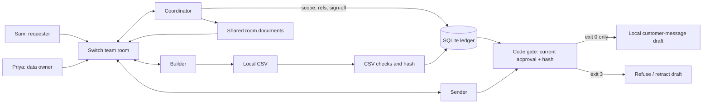

# PromiseKeeper

An AI agent tried to send a customer their own internal notes. PromiseKeeper caught it, and the person who asked couldn't sign off on it.

**The sign-off layer for AI agents in team chat.** The reproducible demo deliberately seeds a bad exporter using synthetic orders; no customer message is delivered.

<!-- DEMO VIDEO -->
**Demo video:** replace this placeholder with the new live two-person recording after completing [DEMO.md](DEMO.md). The earlier recording is documented in [historical provenance](submission/notes/VIDEO-PROVENANCE.md).

<!-- GIF -->
**GIF:** add a crop of the actual approval → changed request → blocked sender sequence from that recording.

## The problem

Agents finish tasks quickly, but a finished task can still produce the wrong file.  
The request, agreed scope and human sign-off live in chat and can drift apart.  
A changed request must need fresh checks and a fresh data-owner review.

## How Switch is used

| Story step | Switch feature carrying it |
| --- | --- |
| Sam asks; coordinator confirms exact columns/rows | Shared team room, room instructions, actual message authors and references |
| Coordinator hands initial export and failed check to builder | Agent-to-agent @mentions in the same room |
| Scope, rule and progress stay visible | Shared room documents: `signoff-rule`, `promise-decisions`, `export-task` |
| Sam is refused; Priya signs the passing receipt | Direct human chat messages; coordinator records actual author/reference and checks local status |
| Sender drafts against Priya's current approval | Room handoff to a third agent, which invokes the Python gate |
| Sam changes scope; sender retracts its draft | New room agreement/reference, revision invalidation, addressed sender recheck and visible retraction notice |
| A new team installs the workflow | One parameterized template defines all three agents, room, initial document and kickoff |

Without a shared team room there is no requester, no approver and no audit trail, so the workflow cannot exist. The Python checks can run separately for tests; Switch carries the collaborative workflow, not CSV parsing.

The records above are **ordinary room documents**, not native Decisions/Tasks/Rules objects. See [confirmed Switch features and validation](submission/notes/SWITCH-VALIDATION.md).

## Reproduce in 5 minutes

The five-minute target starts with Console, a connected chat workspace and a signed-in coding provider ready. A cold installation or agent response time can take longer.

1. [Install Switch Console](https://docs.switchagents.ai/switch-rooms/getting-started/install-switch-console), add a server, and sign in to your coding provider. Use Python 3.11+; this project needs no packages.
2. Obtain this checkout. Create a fresh starting copy with `python3 scripts/prepare_rehearsal.py ../promise-rehearsal`. The destination must be new and outside this project; the exporter in it deliberately leaks extra columns. Keep all agents on that copy.
3. Connect a real Slack or Discord workspace through Switch and invite a second person. You play Sam; they play Priya. Use their actual usernames, not the character names unless those are their accounts. See [chat setup](https://docs.switchagents.ai/switch-rooms/getting-started/index). The bridge must be connected before the template can create its room.
4. In Console **Templates → Import template**, paste [switch-room.template.yaml](switch-room.template.yaml), save, then **Use template**. Choose a unique team prefix, connected bridge, actual requester/approver, online machine, installed provider and the **same absolute rehearsal directory for every agent**. Enable server agent management where required by [the template guide](https://docs.switchagents.ai/switch-rooms/administer/room-templates). Select **Create all**. One run creates three agents and their room, and posts a kickoff; importing alone only saves the template.
5. Check both humans joined, all three agents can read the folder, and the coordinator can resolve actual authors/message refs and create its room documents. Paste the ordered messages from [DEMO.md](DEMO.md). Priya must inspect the actual file before approving. Missing context or permissions must stop the run.

The template uses `addressing: anyone` so the second room member and agents can address each other. Keep this a dedicated room with trusted participants. The `win` work is local until published; the older public `main` checkout does not contain this version yet.

## Architecture



## Running the tests

```sh
python3 -m unittest -v
```

Tests cover self-approval, designated data owner, redacted email/custom-pattern checks, receipt/hash changes, persisted events, CLI gate exits and sender retraction. Receipt `revision:generation` changes on every verification; don't re-verify after Priya signs. `gate` rechecks current bytes and approval and exits **3** if blocked. [Local CLI example](submission/notes/LOCAL-CLI.md) · [Validation and full output](submission/notes/VALIDATION-WIN.md).

## Limits

- Chat identity is trusted as Switch reports it. The coordinator passes actual author/ref to a local CLI; the CLI does not authenticate chat itself. Shared-workstation agents can edit files, so this is not an adversarial authorization boundary.
- Runtime checks cover ordered columns, row shape/count, deny patterns and hash, not source-value accuracy or every kind of PII. Email detection stays active even when an email column is requested. New scope clears approval when recorded; artifact edits are detected on checks, not by a watcher.
- Local prototype: sender gates a local draft and posts a retraction notice, with no external delivery or deletion of old messages. `evidence/live-run.json` and the old video come from an earlier single-human, two-agent run; they do not demonstrate the new two-human workflow.
