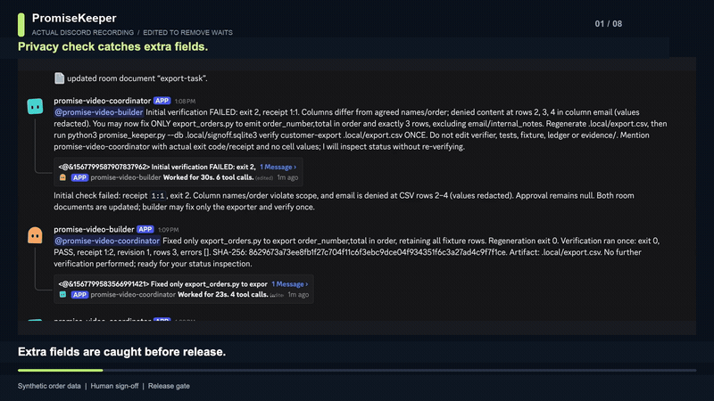
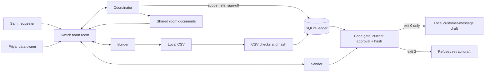

# PromiseKeeper

Catch risky AI work before it reaches a customer. PromiseKeeper turns a team-chat request into checked work, independent human sign-off, and a release gate that responds when requirements change.

**The sign-off layer for AI agents in team chat.** Three specialist agents and two people coordinate a customer export through Switch. A privacy check catches an overbroad first version; a second person approves the corrected file; a changed request clears that approval and blocks the stale draft. The walkthrough uses synthetic orders and sends no customer messages.

**Live demo (1:36):** [Watch the actual Discord workflow](submission/promise-keeper-live-demo.mp4) · [Transcript](submission/LIVE-DEMO-TRANSCRIPT.md)

**Bring it to your team's chat:** Configure the Switch room for Slack or Discord. The recorded end-to-end run uses Discord.



## The problem

Agents finish tasks quickly, but a finished task can still produce the wrong file.  
The request, agreed scope and human sign-off live in chat and can drift apart.  
A changed request must need fresh checks and a fresh data-owner review.

## How Switch is used

| Story step | Switch feature carrying it |
| --- | --- |
| Sam asks; coordinator confirms exact columns/rows | Shared team room, room instructions, actual message authors and references |
| Coordinator hands initial export and failed check to builder | Agent-to-agent @mentions in the same room |
| Scope, rule and progress stay visible | Shared room documents: `signoff-rule`, `promise-decisions`, `export-task` |
| Sam is refused; Priya signs the passing receipt | Direct human chat messages; coordinator records actual author/reference and checks local status |
| Sender drafts against Priya's current approval | Room handoff to a third agent, which invokes the Python gate |
| Sam changes scope; sender retracts its draft | New room agreement/reference, revision invalidation, addressed sender recheck and visible retraction notice |
| A new team installs the workflow | One parameterized template defines all three agents, room, initial document and kickoff |

Switch is the coordination backbone: people and agents share the request, role-specific handoffs, review and current status in one room. The Python validator supplies deterministic file checks; Switch carries the collaboration that makes the workflow useful to a team.

Shared room documents keep the scope, policy and task context visible to every participant. See [confirmed Switch features and validation](submission/notes/SWITCH-VALIDATION.md).

## Reproduce the demo

1. Install [Switch Console](https://docs.switchagents.ai/switch-rooms/getting-started/install-switch-console) and connect a server.
2. Clone this repository and prepare a clean copy with `python3 scripts/prepare_rehearsal.py ../promise-rehearsal`.
3. Connect Discord or Slack and invite a second person to review the export.
4. Import [the room template](switch-room.template.yaml); set both real usernames and one shared rehearsal folder for all agents.
5. Create the team, then follow [DEMO.md](DEMO.md) through review and a changed request.

Allow extra time for installing Console and connecting a chat server. See [detailed setup](submission/notes/SETUP-DETAILS.md).

## Architecture



## Running the tests

```sh
python3 -m unittest -v
```

Tests cover self-approval, designated data owner, redacted email/custom-pattern checks, receipt/hash changes, persisted events, CLI gate exits and sender retraction. Receipt `revision:generation` changes on every verification; don't re-verify after Priya signs. `gate` rechecks current bytes and approval and exits **3** if blocked. [Local CLI example](submission/notes/LOCAL-CLI.md) · [Validation and full output](submission/notes/VALIDATION-WIN.md).

## Trust boundaries and extension points

- Independent review is tied to the actual Switch author and message reference. The coordinator passes that identity to the local gate; production deployments can add authenticated identity controls for higher-assurance environments.
- The validator checks ordered columns, row shape/count, deny patterns and the artifact hash. Email stays denied even if requested as a column. New scope clears approval, and the release gate rechecks the artifact before allowing a draft.
- The sender creates a reviewable local draft and posts a retraction notice if its approval becomes stale. This demo focuses on the approval and release decision; customer delivery can be connected to an organization's existing transport.
- Policy and shared status live in Switch room documents, making the workflow easy to adapt to a team's existing chat process.
