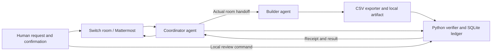

# PromiseKeeper

A Switch Business Workflow prototype: agree on a customer export in chat, build it, verify the output, and review the exact version that passed.

[Watch the 94-second walkthrough](submission/promise-keeper-v2.mp4) · [Blog draft](submission/BLOG-DRAFT.md) · [Wispr usage evidence](submission/WISPR-USAGE.md)

## Current status

Implemented and locally tested: a SQLite evidence ledger, CSV column/row-count checks, versioned agreements, verification receipts, approval invalidation, and a sample exporter using synthetic data.

A live Mattermost-backed Switch room and both agents are configured locally. The first live run completed: agreement, agent-to-agent handoff, failed export check, actual exporter fix, passing verification, local human review, then a requirement change clearing the old approval. The recorded ledger events are in `evidence/live-run.json`; they are not a substitute for a demo video or proof of authenticated chat approval. The sample exporter is now fixed for the original two-column agreement. This repository remains a prototype, not a completed hackathon submission.

## Run locally

Python 3.11+; no third-party packages.

```sh
python3 -m unittest -v
python3 promise_keeper.py --db .local/example.sqlite3 agree example --fields order_number total --rows 3 --request-ref 'local-example:not-a-switch-message'
python3 export_orders.py --output .local/example.csv
python3 promise_keeper.py --db .local/example.sqlite3 verify example .local/example.csv
```

These local-only commands use a separate example ledger and artifact; they do not replace the completed live run. The example reference is explicitly not a Switch message. For actual room operation, preserve the real confirmation reference.

In the first live run, the starting exporter included `email` and `internal_notes`; verification rejected that artifact with code 2, and the builder fixed the exporter. The failure and later receipts are preserved in the evidence file. To create an isolated copy of that starting state, run:

```sh
python3 scripts/prepare_rehearsal.py ../promise-keeper-rehearsal
```

The destination must not already exist. It contains an intentionally flawed exporter and no live ledger or credentials. Point separate Switch agents at that folder for a fresh demonstration. Its exporter regression test deliberately fails until the builder corrects it. Do not weaken the verifier merely to make an export pass.

After a passing verification, the human reviewer inspects the file and runs:

```sh
python3 promise_keeper.py --db .local/example.sqlite3 approve example --receipt REPLACE_WITH_LATEST_RECEIPT --reviewer YOUR_REVIEWER_LABEL
python3 promise_keeper.py --db .local/example.sqlite3 status example
python3 promise_keeper.py --db .local/example.sqlite3 events example
```

Every `agree` command creates a new agreement revision. Every `verify` command creates a new receipt and revokes prior approval, even for identical bytes. Approval also checks the current artifact bytes against the verified hash. `status` rechecks the artifact and revokes approval if it is missing or changed.

## Exact limits

- Verification checks ordered column names, row shape, row count, and the artifact hash. It does **not** verify cell values against source orders or prove correctness beyond these checks.
- The reviewer label and conversation reference are supplied by the caller, not authenticated. In the current demo the human executes approval in a terminal; do not claim approval is securely authorized through chat.
- Agents and the local owner share a trusted workstation. Agent instructions are conventions, not an access-control boundary. SQLite and the verifier are not tamper-resistant against someone with filesystem access.
- Artifact changes are detected when `verify`, `approve`, or `status` runs. There is no continuous watcher, and files are not immutable snapshots. Check status before drafting any customer update.
- Live authenticated chat approvals and immutable artifacts are future work, not implemented features.

## Set up the Switch workflow

Follow the current [installation guide](https://docs.switchagents.ai/switch-rooms/getting-started/install-switch-console) and [quickstart](https://docs.switchagents.ai/switch-rooms/getting-started/index).

1. Run Docker Desktop for bundled Mattermost, install Switch Console, add a local server, and verify the AI provider is signed in.
2. Register two agents called `promise-coordinator` and `promise-builder`. Set each one's directory to this project folder. Paste the corresponding brief from `agents/` into its agent instructions.
3. Create one Mattermost-backed room named `promise-keeper`. Add both agents. Allow your own agents to address one another; the documented default is “Me and my agents”.
4. Paste `agents/room-instructions.md` into the room instructions. Ask the agents to confirm they can read this README and list the actual commands available here.
5. Dictate the first request from `DEMO.md`. Capture the real room/message reference in the agreement. Keep all work in that request's thread where supported.
6. Import the included `switch-room.template.yaml` using Templates → Import template, or create the room manually. This file was captured from the actual working room and Switch's round-trip check reported it valid. It asks for a room name and existing agent names (`deploy_agent` is the builder; `agent_1` is the coordinator). It does not create agents. Its bridge is named `Mattermost`, participant is `user`, and room visibility is public within the local workspace: review those settings before using another server. Importing it on a fresh independent server has not been tested.

Current agent onboarding instructions: [Onboard agents](https://docs.switchagents.ai/switch-rooms/getting-started/onboard-your-agents). Template guide: [Switch room templates](https://docs.switchagents.ai/switch-rooms/administer/room-templates).

## Architecture



Switch provides the actual collaborative path. The local verifier can also run independently for tests; the project does not claim that hashing or CSV parsing requires Switch.

## Observed first run

| Evidence | Result |
| --- | --- |
| Revision 1 | Confirmed two columns and three rows |
| Receipt `1:1` | Failed: extra email and internal_notes |
| Receipts `1:2`, then `1:3` | Corrected artifact passed; coordinator's receipt superseded builder's |
| Local review | Reviewer recorded approval of `1:3` |
| Revision 2 | Added email requirement; verification and approval cleared |

See `evidence/live-run.json`. The runtime verifier does not establish source-value accuracy; `test_export.py` separately checks the corrected sample exporter against the included fixture. Nine automated tests pass in the prepared project.

## Submission materials

- `START-HERE.md`: participant's plain-language guide and remaining actions.
- `submission/promise-keeper-walkthrough.mp4`: 1:34 narrated walkthrough with English subtitles, using actual supplied room screenshots and saved ledger evidence. Not a new live screen recording. See `submission/VIDEO-PROVENANCE.md` for sources.
- `submission/BLOG-DRAFT.md`: reviewed-facts blog draft; not published.
- `submission/VIDEO-SCRIPT.md`: narration and shot list.
- `submission/SUBMISSION.md`: project description, social draft, and remaining submission gates.
- `submission/VALIDATION.md`: clean-extraction tests and verification results.

## Submission strategy

- Primary target: Best Business Workflow.
- Wispr: the participant dictates real requests, instructions, feedback, and documentation during the build, then includes the actual Insights scorecard. Automated coding alone does not prove voice usage.
- Blog: explain the real setup, failure, fix, and limitations with screenshots from the working room.
- Social: use a short clip from the same demo; publishing requires the participant's authorization.
- Track 3 issue #804: assignment was requested separately. It is optional and must not hold up this main workflow; no implementation started for that issue.

No prize or eligibility outcome is guaranteed. Verify the submission form and current rules before entering.
