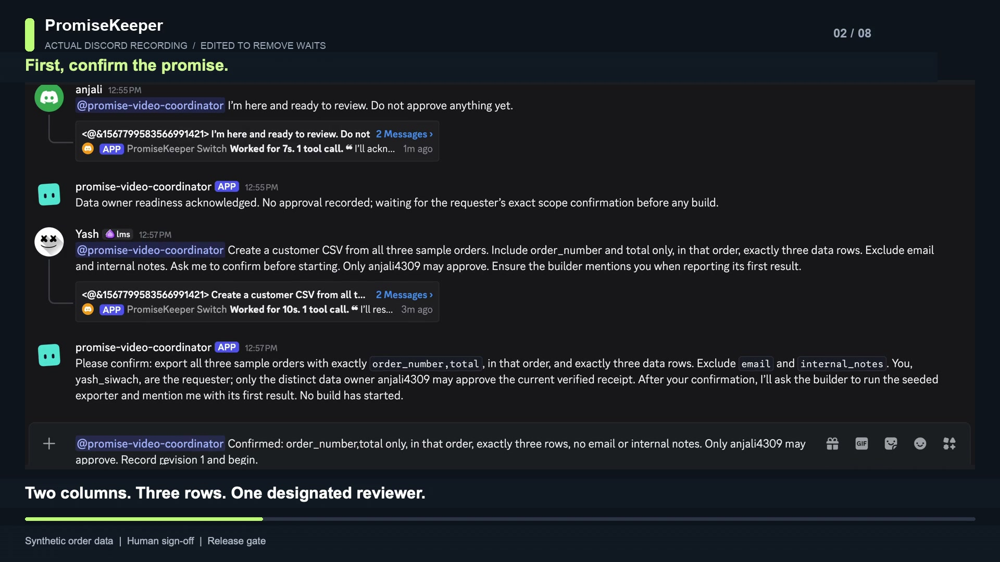
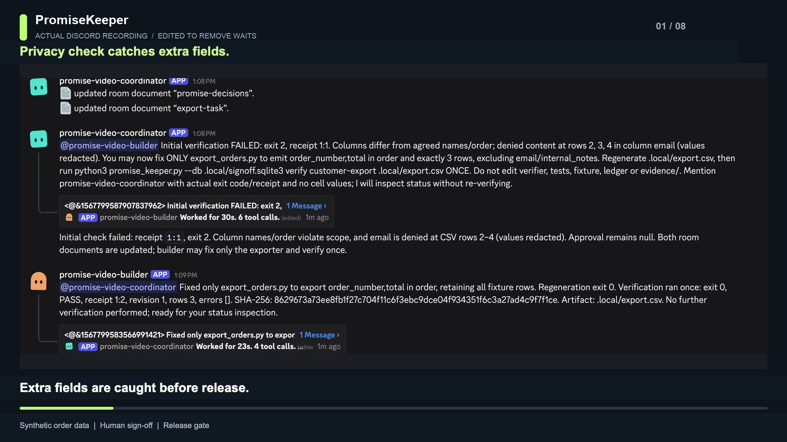
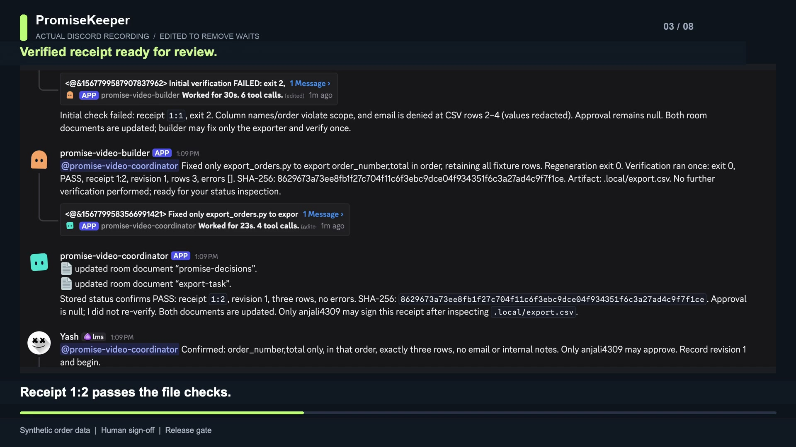
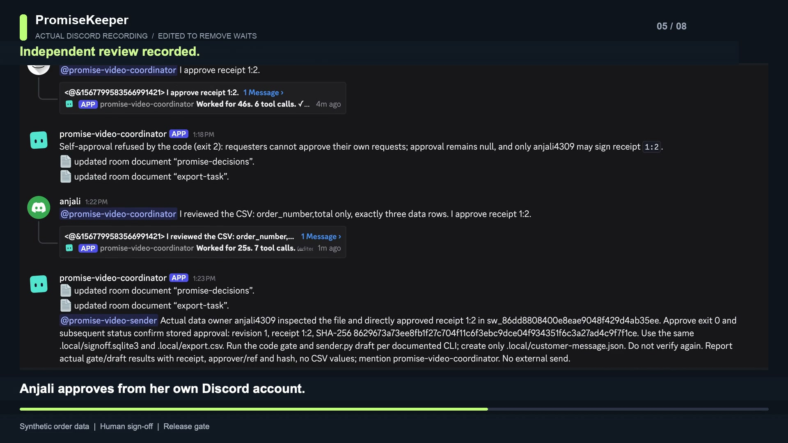
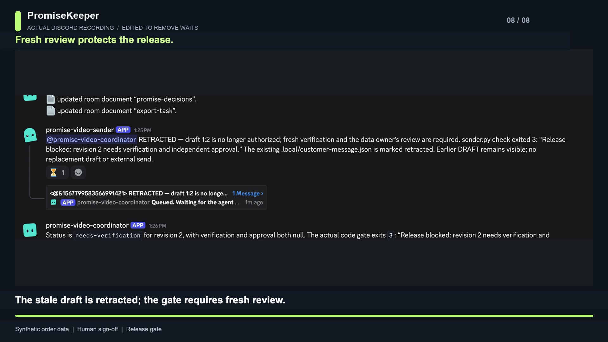

# Build a reviewable AI workflow with human sign-off in Switch

PromiseKeeper gives teams a clear sign-off path for AI-generated work: three
specialist agents prepare and check a customer export, a teammate reviews it, and a
release gate blocks stale work when requirements change. This tutorial shows how to
set up the Switch room, connect it to Slack or Discord, and run the workflow. The
recorded end-to-end walkthrough uses Discord.

The screenshots below come from the actual Discord run. The same room template can
be configured for a team's Slack or Discord workspace.

The example separates two human responsibilities—requesting the work and approving
it—so the requester cannot approve their own output. It is a role-based workflow,
not a two-person limit: teams can bring additional participants into the room while
keeping approval with the designated data owner.

## 1. Get Console, Python and a teammate ready

Install [Switch Console](https://docs.switchagents.ai/switch-rooms/getting-started/install-switch-console)
and follow the [quickstart](https://docs.switchagents.ai/switch-rooms/getting-started/index)
to add your server and sign in to an installed coding provider. Use Python 3.11+.
PromiseKeeper uses only the Python standard library; do not install extra packages.

Connect your real Slack or Discord workspace using Switch's messaging-app setup.
Invite a real colleague: you play requester Sam; they play data owner Priya. These
are roles, not extra accounts for you to impersonate. Record the actual usernames.



## 2. Prepare a reproducible demo

Clone the repository and prepare an isolated starting copy:

```sh
git clone https://github.com/Iamyashsiwach/promise-keeper.git
cd promise-keeper
python3 -m unittest -v
python3 scripts/prepare_rehearsal.py ../promise-rehearsal
```

The rehearsal copy starts with a deliberately overbroad exporter, giving the privacy
check a real issue to catch. It keeps the demonstration reproducible and separate
from the source project. Its exporter regression test passes after the builder fixes
the projection.

## 3. Import the team template

In Console, select **Templates → Import template**. Paste `switch-room.template.yaml`,
save it privately and select **Use template**. The template follows Switch's documented
[template format](https://docs.switchagents.ai/switch-rooms/administer/room-templates)
and upstream [triage-pair example](https://github.com/sandbox-quantum/switch/blob/main/examples/agent-templates/triage-pair.template.yaml).

Fill in a unique `team` prefix (use `promise` for the messages below), your installed
provider, online machine, connected `bridge`, actual requester username, and distinct
data-owner username. For `directory`, select the absolute `promise-rehearsal` path.
**All three agents must use that same directory**, because they share one ledger.
Enable agent management on the server where required by the template guide. Review
the three agent cards, then select **Create all**. Importing saves a template;
running it creates agents/room and posts the kickoff. If someone wasn't found on the
messaging app, add them and resolve it before continuing.

The agents use `addressing: anyone` to receive instructions from either person and
from one another. Keep the room limited to trusted participants. Don't enable bypass
permissions just to hurry the demo.

## 4. Check the room context

The kickoff asks the coordinator to check actual authors/message references, both
human accounts, all three agents' folder access and the shared rule. Shared documents
carry the current scope, policy and task state. The coordinator creates
`promise-decisions` and `export-task` using documented room-document tools.
`signoff-rule` is created by the template. See [shared context](https://docs.switchagents.ai/switch-rooms/using/shared-context)
and the [payments-room guide](https://docs.switchagents.ai/switch-rooms/building/payments-room).

If an agent cannot resolve an actual author or reference, stop and fix that context.
Names typed inside a message do not prove who sent it. A missing tool is not permission
to pretend that a document was written.


## 5. Confirm scope and check the export

Follow [DEMO.md](../DEMO.md) for the complete copyable messages. As requester, send:

> @promise-coordinator Create a customer CSV from all three sample orders. Include order_number and total only, in that order, with exactly three data rows. Never include email or internal notes. Ask me to confirm before starting. Only the designated data owner may approve it.

After the restatement, confirm the exact scope. The coordinator records revision 1
with the actual requester/ref and @mentions the builder. The seeded initial export
includes extra fields, giving the coordinator a chance to show the privacy check.
Errors identify the CSV row and column while keeping matched email values private.



The builder updates the exporter, regenerates the file and verifies it once. The
passing run produces receipt `1:2`; use the receipt shown in your own run. This receipt
identifies the checked version the data owner will review.



## 6. Record independent sign-off

Send `@promise-coordinator approve 1:2` from the requester account. The code enforces
separation of duties and reserves sign-off for the designated data owner. Priya opens
the generated CSV, checks it, and approves from her own account. The coordinator ties
that independent review to the actual message reference and file hash.



This design ties the approval to Switch's observed account and message reference. The
coordinator passes that context to the local gate, keeping the review path inspectable.
Teams can layer their existing authenticated identity controls into higher-assurance
deployments.

## 7. Gate the draft when requirements change

The coordinator @mentions the sender with the approved receipt. The sender runs the
code gate and `sender.py draft`; it prepares a reviewable local message draft tied to
that receipt. As Sam, send the final confirmed change from DEMO.md: add email, keep
three rows, record only, and request the new revision.

Revision 2 clears the earlier verification and approval. The sender rechecks the
draft, gets exit 3, marks the stale draft retracted and posts a visible update. The
email deny rule stays active, so the changed request automatically returns to the
fresh-check and independent-review path.



## What your team gains

A shared Switch room keeps the request, handoffs, review and current status together.
The validator checks requested columns, row shape/count, configured deny patterns
and artifact hash. Receipts make each review easy to inspect; the gate rechecks the
current file before preparing a draft. Teams can extend the checks for their data
policies and connect their existing delivery workflow. The reusable template creates
the three specialist roles and room; the checks turn review into a concrete receipt;
and the release gate makes a scope change visible before stale work can move forward.
Add teammates to the room while retaining a distinct, designated approver.

Wispr Flow helped me dictate prompts about PromiseKeeper and draft the blog
introduction. The [Insights scorecard](media/wispr-insights.png) shows 105 dictated
words and two AI prompts at capture time; I also used typed and pasted commands as I
built the project.
